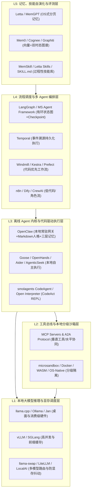

# GitHub 本地大模型、离线 Agent、代码驱动自动化与工作流调度开源项目系统调研报告

> **调研基准日期**：2026-11-27  
> **调研目标**：围绕“在个人本地电脑上构建完全离线/本地优先、程序调度本地大模型与 Agent、支持任务路由与经验技能持续演化的模块化系统”，系统梳理 GitHub 生态的成熟实现思路、模块边界、部署方式与现实局限，为后续乐高积木式 PRD 提供直接可落地的架构依据。

---

## 1. 全景生态分层图谱

经过 2024–2026 年的快速演进，GitHub 上的本地智能自动化生态已经从“单一聊天壳子 + 硬编码 Prompt”收敛为清晰的分层基础设施栈，核心围绕 **OpenAI 兼容接口 + MCP（垂直工具协议）+ A2A（水平协同协议）+ Markdown/Git 技能包** 形成互操作标准：

---

## 2. 分领域开源项目深度剖析

### 2.1 领域一：本地大模型推理与显存调度（Local LLM Runtime & VRAM Router）

个人电脑运行多 Agent/多流程系统的最大硬约束并非“能否跑起来”，而是 **有限显存下的多模型共存与切换开销（VRAM Thrashing）**——例如路由模型（3B–8B）、代码/推理主力模型（14B–32B）、视觉模型与向量嵌入模型在单张 16GB/24GB 显卡或 32GB/64GB 统一内存上的动态调配。

| 代表项目 | GitHub 定位与体量 | 核心架构与模块划分 | 本地部署方式 | 核心局限 |
| :--- | :--- | :--- | :--- | :--- |
| **`ggml-org/llama.cpp`** | 底层 C/C++ 推理引擎（~136k★） | GGUF 量化格式、异构后端（CUDA/Metal/Vulkan/SYCL）、`llama-server`（内置 OpenAI API 与 Router 模式）、精细 KV Cache 量化（`--cache-type-k/v`）与 CPU/GPU 分层卸载 | 单二进制编译/预编译包，零 Python 依赖，支持边缘设备到工作站 | 原生缺少上层任务队列与精细多模型生命周期编排，参数调优门槛较高 |
| **`ollama/ollama`** | 开发者首选本地模型管理器（~187k★） | Go 控制面封装 `llama.cpp`、Modelfile 镜像规范、本地模型仓库拉取与 REST/OpenAI 兼容 API | 原生安装包（Win/Mac/Linux）或 Docker，一条命令启动 | 偏向单用户/单活跃模型假设；多 Agent 并发请求不同模型时极易触发频繁加载/卸载导致延迟雪崩 |
| **`mostlygeek/llama-swap`** | 轻量级本地多模型代理与热切器 | Go 单二进制反向代理 + 进程守护器；通过模型组（Groups/互斥规则）与 TTL 自动启停后端 `llama-server`，暴露统一 `/v1` 接口 | 单二进制 + YAML 配置，直接挂在 `llama-server` 前端 | 本质是请求级代理，本身不做任务语义分类或跨批次亲和排程 |
| **`vllm-project/vllm`** & **`sgl-project/sglang`** | 高吞吐服务与前缀缓存引擎（~97k★ / ~39k★） | vLLM 核心为 PagedAttention + Continuous Batching；SGLang 核心为 **RadixAttention 树状前缀缓存**（极适合多轮 Agent 共享 System Prompt 与结构化约束解码） | Linux/WSL2 + NVIDIA/AMD GPU Docker 或 Python 环境 | 对 Windows 原生与消费级低显存混合 CPU 卸载支持远不如 `llama.cpp`；显存预占较重 |
| **`LocalAI/LocalAI`** & **`janhq/jan`** | 多模态统一网关 / 离线桌面端（Jan ~45k★） | LocalAI 以多后端路由器统一文本/语音/图像/向量接口；Jan 为 Electron 桌面应用内置 `llama.cpp` 与本地 API Server | LocalAI 主打 Docker Compose；Jan 主打桌面一键安装包 | LocalAI 容器栈偏重；Jan 侧重个人对话 GUI，缺少程序化工作流调度能力 |
| **`BerriAI/litellm`** & **`containers/ramalama`** | 统一模型网关 / OCI 容器化模型管理 | LiteLLM 抽象百余种云/本地模型提供路由、降级、限流与成本观测；RamaLama 将模型当作 OCI 镜像用 Podman/Docker 隔离运行 | Python 服务 / Docker；Podman OCI 容器 | LiteLLM 面对单机显卡时需额外配置 **Model Affinity（模型亲和批处理）** 否则仍会触发显存抖动 |

**可借鉴实现思路**：
1. **引擎与控制面解耦**：上层调度器只依赖标准 OpenAI-Compatible API（带 `model` 别名），底层可在 `Ollama`（极简入门）、`llama-swap + llama-server`（单机多模型精细控显存）、`SGLang`（多轮 Agent 前缀缓存加速）间无痛替换。
2. **显存预算与亲和调度**：借鉴 `llama-swap` 的互斥组/TTL 机制、CUDA Unified Memory 热切技巧（大内存主机通过 PCIe 换页替代磁盘冷加载），以及 **Model Affinity Queue**（将同一模型的待执行任务聚批跑完再切模型），彻底消除多 Agent 交替调用造成的“显存乒乓效应”。

---

### 2.2 领域二：完全离线与本地优先 Agent 框架（Offline & Local-First Agents）

这一领域在 2025–2026 年出现了明显的范式分化：一类走向 **常驻守护进程 + 文件即配置（Local-First Personal OS）**，另一类走向 **强隔离沙箱的自主软件工程执行体**。

| 代表项目 | 核心定位 | 架构与模块划分 | 本地部署方式 | 核心局限 |
| :--- | :--- | :--- | :--- | :--- |
| **`openclaw/openclaw`** | 本地优先常驻个人 AI Agent 生态 | **WebSocket Gateway 守护进程**（控制面）+ Agent Runtime + **Markdown 身份与规范文件**（`SOUL.md`/`AGENTS.md`/`USER.md`）+ 三层记忆 + `ClawHub` 技能库 + 后台定时任务（Cron）与子 Agent（`sessions_spawn`） | 原生跨平台常驻服务（Win/Mac/Linux），支持接本地 Ollama/`llama.cpp` 或云模型 | 缺少强确定性的 DAG 编排与工业级事务恢复；高自由度执行对小参数本地模型稳定性要求高 |
| **`block/goose`** | 轻量、MCP 原生的本地自主 Agent（Rust） | **Rust 状态机引擎** + Provider 抽象层（支持内置进程内 `llama.cpp` 零依赖推理或外部 Ollama）+ **全 MCP 扩展层** + 可共享的 **Recipe（配方）顺序自动化系统** | 原生 CLI 与桌面 App（Win/Mac/Linux），零容器依赖 | 默认直接在宿主机执行命令，主要依赖人工弹窗审批而非强 OS 沙箱；小模型复杂规划能力受限 |
| **`All-Hands-AI/OpenHands`** | 开源自主软件工程 Agent 平台（前 OpenDevin） | **完全解耦的三层架构**：类型安全的 Software Agent SDK + REST/WebSocket Agent Server + React Agent Canvas 前端 + 独立 Docker Runtime 沙箱；支持 LiteLLM、MCP 与 micro-agents/hooks | Docker Compose + 独立任务沙箱容器 | 资源占用较重（需常驻 Docker 与多服务）；深度依赖强推理模型，弱本地模型易在复杂多工具循环中卡死 |
| **`Fosowl/agenticSeek`** | 100% 本地化的 Manus 风格通用 Agent | 本地推理模型路由 + 多语言本地代码执行（Python/C/Go/Java）+ 本地浏览器自动化（Selenium）+ 自托管搜索（SearxNG）+ 离线语音交互 | 本地 Python 环境 + Docker（SearxNG/辅助服务） | 模块耦合较紧，偏向通用交互助手而非可编程、可组合的企业级或个人自动化调度内核 |
| **`Aider-AI/aider`** & **`browser-use/browser-use`** | 垂直领域专家 Agent（Git 编程 / 浏览器操控） | Aider 专注代码仓库映射（RepoMap）与 Git 自动原子提交；Browser-Use 通过 Chrome DevTools Protocol（CDP）将 DOM 状态映射给视觉/推理模型 | 轻量 Python CLI / SDK，均可指向本地 Ollama/OpenAI 端点 | 属于高度专精的“执行积木”，缺少跨任务路由、长期经验蒸馏与多阶段编排能力 |

**可借鉴实现思路**：
1. **Gateway 常驻控制面 + Markdown 声明式配置（源自 OpenClaw）**：将人格、规则、约束、技能以人类可直接编辑、Git 可追踪的 Markdown/YAML 文件落地，而非埋在黑盒数据库中，兼顾透明性与可维护性。
2. **全 MCP 化能力接入 + Recipe 固化（源自 Goose）**：所有外部工具不硬编码进核心引擎，统一走 MCP；将已验证的高频操作序列固化为参数化 Recipe。
3. **控制面与执行面彻底解耦（源自 OpenHands）**：调度控制面、Agent SDK、UI/CLI 展示面、隔离执行 Runtime 各自独立通信，避免执行崩溃拖垮主控进程。

---

### 2.3 领域三：代码驱动自动化与本地安全沙箱（CodeAct & Tiered Sandboxing）

传统 JSON Tool-Calling 在本地大模型上存在三大致命伤：**① 本地中小模型 JSON Schema 遵循率低；② 多步循环/数据清洗需多次往返 LLM，吞吐慢且上下文迅速膨胀；③ 缺乏原生变量缓存与条件控制流。** 以 CodeAct 为代表的代码驱动范式正在成为本地自动化的核心突破口。

| 代表项目 | 核心范式 | 架构与实现要点 | 本地部署方式 | 核心局限与安全隐患 |
| :--- | :--- | :--- | :--- | :--- |
| **`huggingface/smolagents`** | 极简 CodeAct 框架（`CodeAgent`） | 核心代码仅约千行；LLM 直接输出 Python 代码块组合循环、条件分支与工具函数，在 REPL 中一次执行并将 stdout/traceback 回灌模型自纠错；支持挂载 MCP 工具与外部沙箱 | 轻量 Python 库（`pip`/`uv`） | 本地默认解释器隔离弱，若不外挂强沙箱，模型幻觉代码可直接破坏宿主机环境 |
| **`OpenInterpreter/open-interpreter`** | 本地 OS/Shell 级代码执行代理 | 在本地持久 REPL 会话中运行 Python/Shell/AppleScript 等，直接操控文件、数据处理与桌面环境 | 本地 Python CLI/SDK | 宿主机权限边界模糊；极易出现“环境依赖漂移”（擅自 `pip install` 破坏全局环境） |
| **`superradcompany/microsandbox`** | 跨平台本地微虚拟机沙箱 | 基于 `libkrun`/Hypervisor 实现 **<100ms 冷启动** 的硬件级隔离 MicroVM；兼容 OCI/Docker 镜像、支持快照分叉（Snapshot/Fork）并原生提供 MCP 接口 | 原生支持 Windows、macOS（Apple Silicon）、Linux | 新兴生态仍在快速演进，部分宿主机硬件/嵌套虚拟化受限环境需降级回退方案 |
| **OS 原生沙箱**（`Seatbelt` / `Bubblewrap` / `Landlock` / `AppContainer`） | 零容器开销的内核/用户态隔离 | macOS 用 `sandbox-exec`（Deny-by-Default 策略）；Linux 用 `bwrap` + `Landlock` + `seccomp`；Windows 用 `AppContainer` / Restricted Tokens | 直接调用宿主 OS 原语，近 0ms 启动 | 跨平台实现碎片化，必须由上层抽象统一策略语言（如目录读写白名单、禁网、禁读 `.ssh`/凭证） |
| **WASM / Pyodide（`wasmer`）** & **`Docker` / `OpenSandbox`** | 进程内内存隔离 vs 标准容器隔离 | WASM/Pyodide 提供微秒级纯计算隔离（哈佛架构代码数据分离）；Docker/Podman 提供完整 Linux 用户态环境与依赖复现 | WASM 嵌入式运行零依赖；Docker 需守护进程（Win/Mac 经由轻量 VM） | WASM 无法直接调用本地二进制 CLI 或复杂 C 扩展；Docker 启动耗时 1–3 秒且需安装容器运行时 |

**可借鉴实现思路**：
1. **CodeAct 作为中复杂任务的默认执行引擎**：把“5 次 JSON 工具调用 + 大数据中转”坍缩为“1 次受控 Python 代码执行”，将中间大对象留在沙箱内存变量中，只把摘要返回 LLM，节省 50%–70% 本地推理 Token 与耗时。
2. **三级安全沙箱路由而非“一刀切”**：
   - 纯文本/数学/JSON/CSV 转换 → **WASM/Pyodide（微秒级、零宿主暴露）**；
   - 受控本地工作区读写与常规脚本 → **OS 原生目录白名单受限进程（近零延迟）**；
   - 需安装依赖、执行陌生代码或高风险 Shell 命令 → **MicroVM（`microsandbox`）或无网 Docker 容器（硬隔离 + 资源配额 cgroups + 执行后销毁）**。
3. **防供应链投毒与防数据外泄**：沙箱默认 **无外网权限（Network Deny-by-Default）**、禁止读取宿主环境变量密钥、严禁未经审批执行 `pip/npm install` 拉取外部包。

---

### 2.4 领域四：工作流调度、持久化编排与多 Agent 协同（Workflow Orchestration）

开源社区已形成明确共识：**“纯确定性工作流”无法处理开放式模糊任务，而“纯自由 Agent 循环”在生产环境中不可控、不可复现且易失控烧算力。** 最佳实践是 **“确定性外骨骼（Workflow/State Machine）+ 概率性内核（LLM/Agent 节点）”**。

| 代表项目 | 核心范式 | 模块划分与持久化能力 | 本地部署资源与依赖 | 核心局限 |
| :--- | :--- | :--- | :--- | :--- |
| **`langchain-ai/langgraph`** | 有环状态图（Stateful Cyclic Graph） | StateGraph 编译器 + 类型化全局 State + 条件边路由 + **原生节点级 Checkpointer（支持 SQLite/Postgres）** + 时间旅行调试 + 原生 `interrupt()` 人工审批挂起/恢复 | 极轻（Python 库 + SQLite，无重型服务依赖） | 简单线性任务样板代码偏多；版本迭代快；本身不包含通用定时调度、模型显存管理或沙箱 |
| **`temporalio/temporal`** | 事件溯源持久化执行引擎 | Server（Frontend/History/Matching/Worker）+ 持久化库 + 多语言 SDK；通过事件日志重放保证跨小时/跨天长任务在崩溃、断电后精确断点续跑 | `temporal server start-dev`（嵌入式 SQLite，约 512MB RAM）或 Docker | 心智模型陡峭（工作流代码必须严格确定性，非确定性调用必须包装为 Activity）；对单机轻量任务略显笨重 |
| **`windmill-labs/windmill`** | 代码优先脚本与内部流引擎 | Worker 节点 + 内置 Postgres + 脚本 IDE（原生 Python/TS/Go/Bash）+ 可视化流编排 + 审批闸门 + 自动 API/UI 生成 | Docker Compose（约 512MB–1GB RAM，强依赖 Postgres） | 每次脚本执行拉起隔离运行环境带来一定延迟；偏向脚本自动化而非自主探索式 Agent |
| **`kestra-io/kestra`** & **`PrefectHQ/prefect`** | 声明式 YAML 流水线 / Python 装饰器编排 | 调度器 + 执行引擎 + 插件体系（Kestra）；Code-as-Workflow 装饰器 + 状态追踪（Prefect） | Docker 或本地单机模式（H2/SQLite） | Kestra 复杂分支用 YAML 表达冗长；二者均偏数据/运维批处理，缺少 Agent 原生上下文与记忆原语 |
| **`n8n-io/n8n`** & **`langgenius/dify`** | 可视化低代码集成 / LLM 应用画布 | n8n 拥有数百 SaaS 连接器 + AI Agent 节点；Dify 一体化提供画布工作流 + RAG + 模型路由 + Token 观测 | n8n 极轻（SQLite，256–512MB RAM）；Dify 需全套 Docker Compose（含向量库/Redis/Postgres，较重） | n8n 超过 50 节点后易演变为难以维护的“面条图”；Dify 为多租户类 SaaS 架构，单机离线改造与深度代码扩展成本高；二者非纯 OSI 宽松协议 |
| **`crewAIInc/crewAI`**, **`pydantic/pydantic-ai`**, **`microsoft/agent-framework`** | 角色流 / 强类型边界 / 图式多 Agent | CrewAI 引入事件驱动 **Flows** 约束角色扮演 **Crews**；PydanticAI 专攻强类型 Schema 校验与依赖注入；微软将 AutoGen 与 Semantic Kernel 统一为支持 Checkpoint 的图式 Agent Framework | 轻量 Python SDK | CrewAI 易出现角色扮演偏移与互相推诿死循环；PydanticAI 不提供完整编排器需组合使用 |

**可借鉴实现思路**：
1. **“LangGraph 状态机 + Temporal 持久化思想 + SQLite 零运维存储”**：在个人电脑上无需直接部署重型 Temporal 集群，只需在核心编排模块中实现 **事件溯源式 Checkpoint（SQLite WAL 模式）+ 幂等步骤缓存 + `interrupt()` 人工审批原语**，即可获得跨重启断点续跑与时间旅行排错能力。
2. **强类型数据契约边界（源自 PydanticAI）**：积木之间绝不用非结构化自然语言裸传状态，每个节点的输入/输出均由 JSON Schema / Pydantic 强校验，本地小模型输出不合格时在节点局部触发自修复重试，阻止错误向下游级联污染。
3. **双轨流程表达（源自 Windmill + CrewAI Flows）**：简单固化流程支持声明式 YAML/JSON 定义（便于机器自动生成与可视化编辑），复杂探索逻辑支持 Python 状态图。

---

### 2.5 领域五：持久化记忆、技能自演化与标准协议（Memory, Self-Evolving Skills & Standards）

“执行一次任务后如何沉淀经验与技能，让系统越用越强”是绝大多数传统工作流工具缺失、但 2025–2026 年最活跃的前沿方向。

| 代表项目 / 规范 | 核心突破 | 技术实现要点 | 本地化适配性 | 核心局限 |
| :--- | :--- | :--- | :--- | :--- |
| **`letta-ai/letta`**（前 MemGPT） | OS 虚拟内存式有状态 Agent | 借鉴操作系统分页，区分常驻上下文块（Core Memory）与归档库（Archival Memory），由 Agent 显式调用工具（`core_memory_replace` 等）自我编辑记忆 | 支持本地部署与本地模型接入 | 依赖模型具备稳定的自我记忆管理判断力，弱小模型可能误删关键记忆或过度写入噪音 |
| **`mem0ai/mem0`** & **`topoteretes/cognee`** & **`getzep/graphiti`** | 混合检索与双时态知识图谱 | Mem0 融合向量+图+KV；Cognee 自托管构建实体关系网；Graphiti 引入 **Bi-Temporal（双时态）图谱**，同时记录“事实生效时间”与“系统录入时间”，原生解决偏好变更与历史事实冲突 | 均可自托管，但原生多依赖 Neo4j/Qdrant/Postgres，单机轻量化时需用 SQLite+FTS5+sqlite-vec+轻量关系表等效裁剪 | 纯向量召回对时序变更和精确规则无力；重型图数据库会显著拉高个人电脑内存占用 |
| **`openclaw` 三层记忆机制** | 文件优先的透明分层记忆 | **Tier 1**：精简常驻 `MEMORY.md`（~100 行核心准则）；**Tier 2**：按日滚动日志 `memory/YYYY-MM-DD.md`；**Tier 3**：本地向量/语义检索引擎 + 后台事实抽取/衰减插件 | **极度契合本地个人电脑**：人类随时可读可改，Git 原生可备份回滚 | 缺少从“记忆”自动升级为“可执行代码技能”并经沙箱验证的闭环 |
| **`MemSkill`** & **`letta-ai/skills`** & **`SKILL.md` 规范** | 从“存事实”迈向“存过程性技能” | MemSkill 将记忆操作本身抽象为可演化的元技能；`SKILL.md` 采用 **渐进式披露（Progressive Disclosure）**——平时仅注入几十 Token 的名称与触发描述，命中后再按需加载完整 SOP、脚本与参考资料 | 本地文件夹即技能包，零外部服务依赖 | 自动化生成新技能若缺乏 **沙箱回归验证闸门**，极易把偶然成功的“脏补丁”固化为毒害系统的错误技能 |
| **MCP** & **A2A**（Linux 基金会 AAIF 托管） | 垂直工具标准与水平协同标准 | **MCP** 负责 Agent ↔ 工具/数据源（`stdio`/Local HTTP）；**A2A** 通过 `Agent Card`（JSON 元数据）实现跨进程、跨框架 Agent 异步任务委派；`a2a-mcp` 桥接二者 | 完美适配本地进程间通信与多语言积木拼装 | 大量 MCP Server 同时挂载会导致工具描述塞爆本地模型的有限上下文窗口（需按需路由加载） |

---

## 3. 共性提炼：现有开源生态在“本地单机落地”的六大核心缺口

综合调研上述 30+ 开源项目，单一开源项目无法直接满足“本地电脑全离线、任务自动路由、多模块乐高组合、经验与技能自演化”的目标，核心存在以下六大结构性缺口：

1. **算力调度与任务编排割裂**：工作流引擎（LangGraph/n8n/Windmill）不懂本地显卡显存预算，多分支并发调用不同模型时会把单机 GPU 拖死在反复加载权重中；而模型代理（`llama-swap`/Ollama）不懂任务优先级与流程上下文。
2. **“确定性流程”与“探索式 Agent”缺乏统一智能路由**：要么全部手工画死流程图（遇到新任务就瘫痪），要么所有简单任务都丢给自由 Agent（慢、贵、不稳定、容易幻觉）。缺少一个位于入口的 **多档位复杂度路由器**。
3. **本地中小模型的可靠性短板未在架构层兜底**：OpenHands、OpenClaw 等框架往往默认背靠云端前沿大模型；一旦切到完全离线的 7B–32B 量化模型，JSON 工具调用漂移、多步规划迷失、上下文超限问题会被成倍放大，必须通过 **CodeAct 减轮次 + 强类型局部自修复 + 步数/状态硬熔断** 从架构层面弥补模型能力差。
4. **安全沙箱在跨平台个人电脑上存在“极简不安全 vs 安全太重”断层**：Goose/Open Interpreter 直接跑在宿主机风险极高；OpenHands 强依赖完整 Docker 栈对普通轻薄本负担偏重。需要面向 Win/Mac/Linux 的 **按风险分级沙箱抽象层**。
5. **缺少“探索 → 验真 → 蒸馏 → 固化降维”的工程闭环**：多数项目把记忆做成了被动 RAG 检索，或把技能做成静态人工插件；很少有系统把 **Agent 踩坑排错后的成功执行轨迹，自动抽象、沙箱测试并晋升为低成本确定性 Skill 积木**，从而让系统在本地越跑越快。
6. **轻量化部署与模块可替换性难以兼得**：全功能平台（如 Dify、Temporal+Neo4j+Qdrant）动辄依赖 5–8 个后台中间件，违背个人电脑“开机即用、低内存占用、离线便携”的诉求；而轻量库又往往缺乏标准化边界，二次开发很快耦合为一团乱麻。

---

## 4. 调研结论向 PRD 的直接映射

| 开源借鉴来源 | 提炼的核心工程机制 | 映射到 PRD 中的乐高积木 |
| :--- | :--- | :--- |
| `OpenClaw` Gateway + Markdown 优先 | 本地守护进程统一接入、人类可读配置与分层目录 | `B01` 统一任务网关 + `B08` File-First 记忆底座 |
| `llama-swap` + `LiteLLM` + `SGLang` | 统一模型别名、显存互斥组、模型亲和批处理、前缀缓存 | `B04` 本地模型网关与显存调度器 |
| `LangGraph` + `Temporal` + `PydanticAI` | 有环状态图、SQLite 节点 Checkpoint、HITL `interrupt()`、强类型 Schema | `B03` 持久化流程编排引擎 + 全局数据契约 |
| `smolagents` + `Goose` + `OpenHands` | CodeAct 代码执行内核、控制面与运行面解耦、全 MCP 扩展 | `B05` Agent 执行内核 + `B06` MCP 工具总线 |
| `microsandbox` + WASM + OS-Native | 三级风险隔离（WASM / OS 沙箱 / MicroVM-Docker）与默认断网 | `B07` 分级本地安全沙箱 |
| `Letta` + `Graphiti` + `MemSkill` + `SKILL.md` | 分层/双时态记忆、渐进式技能加载、执行后复盘蒸馏与沙箱晋升 | `B08` 分层记忆引擎 + `B09` 技能库与自演化引擎 |
| OpenTelemetry + Golden Eval | 本地全链路 Trace 观测、离线回归测试防退化 | `B10` 安全治理、可观测与本地评测引擎 |

> 下一步请参见配套落地方案文档：[local_lego_agent_os_prd.md](./04_汇桥OS_产品需求文档_PRD_v2.2.md)。
