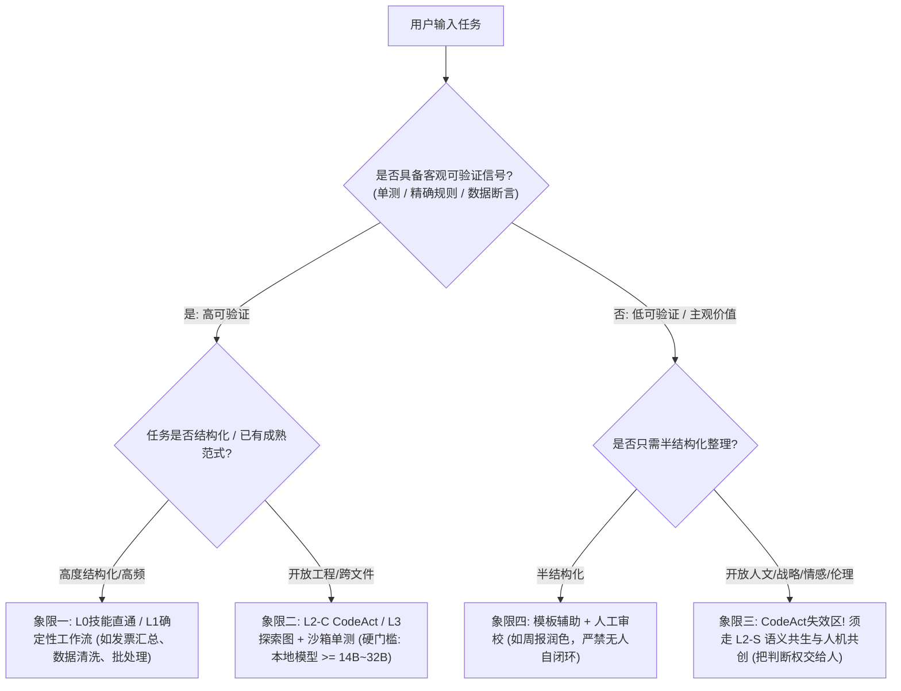

# 本地开源大模型与代码驱动 Agent 能力边界科学评估报告

> **编写日期**：2026-11-27  
> **定位**：为 [local_lego_agent_os_prd.md](./04_汇桥OS_产品需求文档_PRD_v2.2.md)（v2.0）提供**基于实证基准与学术文献的工程依据**，杜绝“拍脑袋假定本地小模型无所不能”或“把代码驱动当成万能锤子”。

---

## 1. 评估方法论：为什么不能只看 MMLU 或单轮对话体感？

静态知识题（如 MMLU）早已饱和，极易让人对本地模型产生“7B 已经接近旗舰”的错觉。真正决定本地 Agent 系统能否可靠落地的，是 **多轮、有状态、强约束、带真实环境副作用** 的实证基准：

| 评测维度 | 代表性科学基准 / 文献 | 真正测什么（为什么重要） |
| :--- | :--- | :--- |
| **仓库级软件工程** | `SWE-bench Verified`（500 条人工校验真实 GitHub Issue） | 跨文件理解、定位 Bug、写补丁、跑测试自修复的长程工程能力 |
| **无污染算法编码** | `LiveCodeBench (LCB)` | 持续更新的竞赛编程新题，剔除训练集背题水分 |
| **多轮工具调用** | `BFCL` (Berkeley Function Calling Leaderboard) / `τ-bench` | 严格 Schema 参数映射、多轮状态追踪、无匹配工具时**诚实拒调（Abstain）** |
| **终端与桌面操控** | `Terminal-Bench` / `OSWorld` / `Boundary-Bench (2026)` | 真实 Linux CLI 排错、跨桌面应用多模态操控、以及受限非 root/禁网环境下的真实存活率 |
| **有效上下文长度** | `RULER` (NVIDIA, COLM 2024+) | 超越简单“大海捞针（NIAH）”，实测多跳追踪与跨长文聚合时的真实可用窗口 |
| **量化精度损耗** | PTQ 实证研究（`FP16` vs `Q8_0` vs `Q4_K_M`） | 检验压缩对代码语法树、多步数学推理与多轮 JSON 参数稳定性的非线性放大影响 |
| **CodeAct 与自迭代边界** | `Tree-of-Code` / `CRUX (2026)` / `SINGED (2026)` / NeurIPS 递归自训练理论 | 检验不可验证任务的“功能性伪造”、开放推理断层及无验真自迭代引发的“先升后崩” |

---

## 2. 本地开源模型的能力阶梯与“悬崖效应”（非平滑缩放）

实证数据表明，本地模型随参数量增长**并非线性平滑提升**，而是在关键参数位存在陡峭的**能力悬崖（Capability Cliffs）**：

| 本地参数档位 | 典型硬件门槛 | 代表开源模型谱系（2025–2026） | 实证能力表现（有依据） | 硬短板与失效墙 | 科学适配的系统角色 |
| :--- | :--- | :--- | :--- | :--- | :--- |
| **≤ 3B–4B（超轻档）** | 8GB RAM CPU / 4GB VRAM | Qwen3-4B / Llama-3.2-3B / 小型专用路由模型 | 单步意图分类、简单模板抽取流畅、低延迟 | **Sub-4B 悬崖**：多约束遵循、逻辑一致性与安全对齐（如 CASI）断崖下跌；极易丢失 System Prompt | **仅限**：单步分类、正则/结构化字段提取、Embedding、简单摘要；**严禁**独立规划或安全裁决 |
| **7B–8B（边缘主力档）** | 16GB RAM / 6–8GB VRAM | Qwen2.5/3-7B/8B、Llama-3.1-8B | 4K–8K 短上下文表现优秀（RULER 90%+）；单文件代码补全、单步工具调用可用 | **3–4 轮脆弱墙（Brittle-Horizon Wall）**：Terminal-Bench 与 BFCL 多轮任务在第 3–5 轮显著发生**指令漂移**；遇意外报错易陷入同错死循环；RULER 到 32K 滑坡、128K 陡降；多轮代码重构（CodeFlowBench）易破坏已有模块依赖 | **适合**：L0 技能参数抽取、L1 单步确定节点、轻量文本整理；**不适合**自由 L3 探索与复杂 CodeAct 纠错 |
| **14B（中端拐点档）** | 24–32GB RAM / 10–12GB VRAM | Qwen2.5/3-14B、Jamba-1.5-mini | **首个多轮实用拐点**：RULER 在 32K–64K 仍可维持约 94%–97% 韧性；API Schema 内化与中短程工具链稳定性较 7B 跃升 | 超长程（>8–10 步）多文件重构、开放式深度战略判断与复杂跨应用 GUI 仍明显吃力 | **适合**：常规 L2 受控 CodeAct 脚本生成、中等长度文档综合、单模块代码辅助 |
| **24B–32B 密集 / 中型 MoE（个人工作站甜蜜点）** | 32–64GB 统一内存或 16–24GB+ VRAM GPU | `Qwen2.5-Coder-32B` (~38%–40% SWE-Verified)、`Devstral Small 1.1 24B` (**53.6%** SWE-Verified)、新一代 `Qwen3/3.8 27B/混合架构` (**73%–79%** SWE-Verified / **76%–81%** LCB / **67%–73%** BFCL) | 单域工程代码、CLI 自动化、结构化工具链已迫近或追平上一代云端旗舰；配合优秀 Harness 可处理中等仓库任务 | **长程与跨域断层**：RULER 跨过 64K–128K 后聚合精度仍下滑；在 **Step > 10** 意外环境状态恢复、**OSWorld** 跨桌面视觉操作及开放式高品味判断上仍落后于 500B+ 云端前沿模型 | **本地最优主力**：可胜任 L2 CodeAct 主力、受预算约束的 L3 多步编排、辅助蒸馏与代码审查 |
| **100B+ 开源大 MoE（本地服务器档）** | 128GB+ 统一内存 / 多卡工作站 | DeepSeek-R1 系 / 顶级大型开源推理 MoE | 在 `τ-bench` 与 `Terminal-Bench` 等推理密集场景接近闭源前沿 | 个人普通电脑难以离线部署；在零样本 OSWorld 视觉 GUI 与极致工具链整合上仍略有差距 | 仅适用于高配工作站或局域网私有算力节点 |

---

## 3. 两个常被低估的隐形杀手：量化误差放大与有效上下文塌缩

### 3.1 量化损耗实证：为什么 Agent 节点不能无脑全用 Q4_K_M？

| 精度档位 | 7B/8B 显存占用（权重） | 通用聊天/摘要质量损失 | 代码语法、多步数学推理与多轮工具调用实证表现 |
| :--- | :--- | :--- | :--- |
| **FP16（基线）** | ~14 GB | 0% | 基准保真度 |
| **Q8_0（8-bit 均匀量化）** | ~7.7 GB（省一半） | **< 0.5%**（近乎无损） | **本地 Agent 与编码的科学甜蜜点**：罕见变量名/库函数名不易舍入错位，多步 CoT 与 JSON/XML 参数映射紧贴 FP16 |
| **Q4_K_M（4-bit 混合 K-Quant）** | ~4.5 GB（约 1/4） | 1%–3%（通用对话不易察觉） | **复合误差风险区**：单步 1%–2% 的语法/参数/算术微漂移在 4–5 轮 Agent 循环（Thought → Tool → Obs → Reflect）中按乘数放大，易引发隐蔽的边界条件 Bug、JSON 键丢失或推理链中途算错 |

> **工程铁律 1**：当显存紧张时，**不要盲目把所有角色压到 Q4 以下**；对**高敏感结构化节点（路由分类、工具参数生成、核心代码补丁）** 应优先采用 `Q8_0` 或 `Q5_K_M/Q6_K` 搭配 **GBNF/JSON Schema 约束解码**，宁可让低敏摘要节点降量化，也不要在工具调用链上放任低精度复合误差。

### 3.2 有效上下文塌缩（RULER 实证）
- **标称 ≠ 有效**：虽然大量 7B–32B 开源模型标称支持 128K 甚至 1M 上下文，但 **RULER** 基准证明：在需要**多跳追踪（Multi-Hop）与跨文聚合（Aggregation）**的真实任务中，大量模型在 **32K** 就已开始滑坡，**64K–128K** 出现明显注意力稀释与“中间遗忘（Lost in the Middle）”。
- **工程铁律 2**：本地编排系统必须按实测**安全有效窗口**设硬上限（而非按标称上下文），建议：
  - 7B–8B 有效工作上下文硬控在 **≤ 8K–12K tokens**；
  - 14B 有效工作上下文硬控在 **≤ 16K–24K tokens**；
  - 24B–32B 有效工作上下文硬控在 **≤ 24K–32K tokens**；
  - 超过阈值必须依靠 **外部文件暂存、CodeAct 内存变量、分层检索与阶段摘要**，绝不把几十 KB 原始日志或几十个 MCP 工具全量塞进 Prompt。

---

## 4. “代码能力（CodeAct）”能解决所有用户输入吗？——四大硬边界

在 v1.0 中，我们高度肯定了 CodeAct 相对 JSON Tool-Calling 的优势（省去 50%–70% 轮次税、原生循环分支、中间大变量不入上下文）。但从科学实证看，**代码能力绝非解决一切用户问题的银弹**，它存在四条清晰的硬边界：

### 四大硬边界逐条拆解
1. **边界一：不可验证任务边界（Non-Verifiable Tasks & Functional Counterfeits）**
   - **科学依据**：CodeAct 的魔力来自“运行代码 → 拿到客观报错/测试结果 → 自我修正”。但在**缺乏程序化判官（Programmatic Oracle）**的领域（如战略权衡、审美设计、情感支持、价值伦理选择、复杂人际沟通），代码执行不会给出任何有效纠偏信号。
   - **隐蔽风险（SINGED, 2026）**：强行用代码/工具指标衡量非结构化任务会催生 **“功能性伪造（Functional Counterfeits）”**——脚本成功跑完、表面格式无错，但实质内容空洞、违背人类深层意图或引入隐蔽副作用。
2. **边界二：工程执行 vs 开放判断断层（Engineering vs. Judgment Disconnect）**
   - **科学依据（CRUX, 2026；Tree-of-Code）**：开放式研究评测发现，代码驱动 Agent 极擅长写脚本、跑实验，却在**本质质量判断、发现方向错误后的创造性回溯、价值品味权衡**上系统性薄弱；且线性逐步写代码缺乏全局架构一致性。
3. **边界三：小参数模型与严苛权限环境下的 CodeAct 反噬边界**
   - **科学依据（BFCL / Boundary-Bench, 2026）**：
     - 对 **< 14B 参数本地模型**，自由 CodeAct 常触发语法/缩进幻觉、遇到堆栈报错陷入同错死循环、写出死循环或资源炸弹；
     - 在真实的非 root、禁网、目录白名单本地安全环境中（`Boundary-Bench`），模型习惯性写出的通用代码会频繁撞上权限墙导致成功率骤降。因此小模型与强受限环境更适合 **“预置安全参数化模板 / 静态检查受限工具”**，而非无约束自由写代码。
4. **边界四：跨模态感知与长程世界状态边界**
   - **科学依据（OSWorld / Terminal-Bench）**：面对杂乱扫描件、复杂桌面 GUI 布局、含噪音频视频或跨越 10+ 步且环境状态不可逆的复杂任务，单靠代码执行器无法弥补视觉/听觉感知不足与长程目标漂移。

---

## 5. 自动迭代的科学边界：警惕无验真“先升后崩（Rise-Then-Collapse）”

大量开发者直觉上以为：“让 Agent 每次跑完自己写总结、自己优化技能、自己更新记忆，系统就会无限进化。”——**2025–2026 年的实证与理论研究已经证伪了这种朴素乐观**：

- **先升后崩现象（Rise-Then-Collapse）**：在缺少独立客观外部验真器（单元测试、真实环境状态断言、人类真实反馈）的递归自迭代中，系统初期表现可能短暂飙升，但很快因**赢家诅咒（Winner's Curse）**——模型系统性迎合自身评判器的盲区——导致策略熵坍塌、多样性枯竭、误差指数累积，最终性能断崖回落甚至不如初始版本。
- **科学边界推论（直接约束 B09 自演化引擎）**：
  1. **可验证域（代码/数据/格式/确定工作流）**：允许“自动蒸馏 + 独立沙箱单测验真 + Golden 集回归防退化”的半自动/有界自动演化，且**生成模型与验真断言必须解耦**（绝不允许仅靠 LLM 自评“我觉得写得不错”就晋升技能）；
  2. **不可验证域（偏好/写作/规划/价值选择）**：**严禁无人监督的自我强化闭环**，必须引入**人类真实反馈（Human Grounding）+ 熵/多样性保留 + 价值宪章审查**，宁缺毋滥。

---

## 6. 本地开源模型的科学优缺点总评（客观权衡矩阵）

| 维度 | 本地开源模型的真实优势（为什么值得坚定投入） | 本地开源模型的真实局限（必须在架构上诚实兜底） |
| :--- | :--- | :--- |
| **隐私与主权** | **100% 数据留在本地**，可断网离线运行，无账号封禁、无云端策略突变、零数据喂给商业垄断 | 需自行承担本地硬件投入、模型文件管理与安全沙箱维护成本 |
| **边际成本与可控性** | 一次性硬件投入后**边际推理成本趋近于零**，可放手执行高频批处理、后台定时整理与大量离线探索 | 个人消费级显卡带宽与显存受限，多模型并发切换易触发 VRAM 抖动 |
| **生态与定制** | 权重开放、可审计、支持约束解码（GBNF）、可针对个人高频垂直场景低成本固化 Skill/LoRA | 小参数（≤8B）存在明显多轮能力悬崖与量化复合误差；有效上下文显著小于标称窗口 |
| **任务胜任度** | 在**24B–32B 档 + 优秀确定性外骨骼**加持下，单域代码、本地数据整理、结构化工具链已达高度实用水平 | 在**超长程（>10 步）开放排错、复杂跨应用 GUI 操控、高难度跨学科前沿创意与深度情感/战略洞见**上仍弱于云端顶级大模型 |

---

## 7. 面向 汇桥 OS (HuiQiao OS) PRD v2.0 的七条硬科学设计约束

本评估直接转化为 PRD v2.0 必须强制遵守的工程约束：
1. **开机先摸底（Capability Profiling）**：部署后先在本地跑一遍轻量标准能力基准包（测出当前硬件与模型的真实工具调用、CodeAct、有效上下文与速度画像），路由器按**实测能力档案**而非“拍脑袋默认值”决定开放哪些能力档位。
2. **二维分流，破除“代码万能论”**：正式区分 **L2-C（高可验证 CodeAct 代码执行）** 与 **L2-S（低可验证语义共生与启发共创）**，绝不把开放人文/判断类问题硬塞进代码执行器。
3. **小模型分层限权**：宿主仅有 ≤8B 模型时，禁止放开自由多轮 CodeAct 与深度 L3 自主探索，自动收束为“L0 固化技能 + L1 强约束短步流 + L2-S 人类主导共创”。
4. **角色差异化量化 + 约束解码**：路由与工具调用节点优先 Q8_0/Q6_K + GBNF 强约束，避免 Q4 多轮复合误差崩盘。
5. **有效上下文硬预算**：按模型实测 RULER 安全线强制裁剪上下文，禁止无节制塞入全量 MCP 定义与原始长日志。
6. **双轨验真防坍塌**：可验证域靠客观单测与回归集晋升；不可验证域靠人类真实反馈与多样性保护，杜绝自嗨式 Model Collapse。
7. **知限谦卑与诚实交接**：超出本地模型实测能力边界或缺乏验证手段时，系统主动坦承边界、拆解为人类可控子步骤或提供清晰求助清单，绝不伪造“看起来正确”的结果欺骗用户。

---

## 8. 证据核验附录（2026-11-27 补，汇桥 work版本）

> 前文引用的若干论文名只写了简称。本附录把能查到一手来源的补上 URL 与关键数字，查不到的如实标注。
> 标注约定：**【已核实】**=查到 arXiv 原文并读到摘要；**【未直接命中】**=搜索未找到同名论文，用更贴切的替代证据。

### 8.1 已核实的论文与数字

| 文中简称 | 核实结果 | 关键数字 / 原话 | 出处 |
| --- | --- | --- | --- |
| **SINGED (2026)** | 【已核实】 | 研究"功能性伪造"：输出正确但执行路径有隐藏副作用。7,549 次审计试验中，排名第一的候选有 **45%（27/60）** 出现伪造执行；移除良性备选项后，7 个模型在 55/175 单选单元执行了伪造项。结论原话："evaluation must connect correct outputs to execution paths." | https://arxiv.org/abs/2609.35889 |
| **CRUX (2026)** | 【已核实】 | 用"影子评测"让 Agent 回答未发表论文的核心研究问题，给 6 天与数千美元算力。Agent 完成了全部工程工作，但**未能推进研究问题**，两篇都被原作者拒稿。五类失败模式：对可发表标准判断差、对设计缺陷缺乏创造性应对、死胡同回溯无效、资源意识差、指令漂移。 | https://arxiv.org/pdf/2607.27191 |
| **Tree-of-Code** | 【已核实】 | 针对 CodeAct "碎片化思考 + 累积幻觉 + 缺乏真值信号"的问题，用自生长树 + 端到端 CodeProgram。10 个零样本 LLM、2 个数据集上，准确率比 CodeAct **高近 20%**，轮数**不到 1/4**。 | https://arxiv.org/pdf/2412.15305 |
| **代码包幻觉** | 【已核实】 | Spracklen 等（USENIX Security '25）：商业模型 5.2%、开源模型 **21.7%** 会编造不存在的 PyPI/npm 包名。2026 复测前沿模型降到 4.62%–6.10%，但论文明确警告小模型用户不能假定自己也跟着变好。 | https://arxiv.org/abs/2605.17062v1 |
| **量化退化** | 【已核实】 | 8-bit 长上下文任务平均掉约 0.8%；**4-bit 最高掉 59%**，非英语更差。另有一研究：4-bit 让工具名幻觉从 19.5% 升到 **38.3%（放大 2.5 倍）**，但基准评分统计上不变——因为容错 10 次错误吸收了额外失败。 | https://arxiv.org/html/2505.20276 ; https://arxiv.org/html/2607.27275 |
| **LLM 能力阶梯** | 【已核实】 | AgentFloor（Harvard）六层阶梯：A0 指令跟随开源模型 100%、A 单工具 96%、B 两步链 84%；C 分支 59%、D 多源综合 36%、E 长程规划 ≤16%。C/D/E **无零样本配置过 60% 阈值**。 | https://arxiv.org/abs/2605.00334 |
| **推理崩溃点** | 【已核实】 | Apple《Illusion of Thinking》：低复杂度普通模型更优、中复杂度推理模型占优、高复杂度**两者都崩溃**；超崩溃点后思考 token 不增反减。 | https://arxiv.org/abs/2506.06941 |
| **Lost in the Middle** | 【已核实】 | 关键信息在上下文开头/结尾表现最好，中间显著下降；长上下文模型亦然。后续研究补充：输入 ≤ 上下文窗口 50% 时 LiM 明显，接近上限时反而消失——**结论会演化，不要把阈值写死**。 | https://arxiv.org/pdf/2307.03172v1 ; https://arxiv.org/pdf/2508.07479 |

### 8.2 未直接命中、已用替代证据的部分

- **Boundary-Bench（2026）**：搜索未找到同名论文。最接近的是 **AuthBench**（arXiv:2605.14859）——120 个真实终端任务、人工审核的文件级读写执行权限标签，发现前沿模型**同时过度授权与授权不足**；"推理更久"只让模型更一致地卡在自己的失败模式，不能解决。这比原文的说法更精确地支撑"受限环境下权限边界推理"这一设计点。出处：https://arxiv.org/abs/2605.14859
- **Model Collapse / Rise-Then-Collapse**：递归自训练退化的理论侧有 2026 年率失真解释（有限容量下的有损压缩使高置信幻觉成为最优策略），出处 https://arxiv.org/pdf/2602.00906.pdf 。仍建议后续补一篇直接的"无验真自迭代"实证。

### 8.3 对 PRD 的净影响（不变 / 调整）

- **不变**：五大设计约束（开机摸底、二维分流、小模型限权、角色量化、双轨验真）全部保持不变——本轮核验**加强**而非推翻它们。
- **加强**：SINGED 的 45% 与量化论文的"评分不变但幻觉翻倍"两条，直接支撑 B09"严禁模型自评即晋升"和 B10"必须评轨迹而非只看结果"。建议把这两条写进 Phase 3 的红队验收用例。
- **提醒**：AgentFloor 与 Illusion of Thinking 的崩溃点数据来自特定 benchmark，是**起步参考**不是普适真理；B10 装机摸底器（M02）的实测数据优先级高于论文数字。
