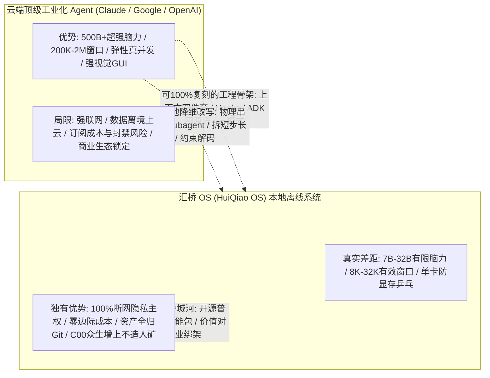

# 线上顶级 Agent 工业化流程拆解与本地系统差距对标报告

> **调研基准日期**：2026-11-27  
> **对标对象**：Anthropic **Claude**（Claude Code / Agent SDK）、Google **Gemini Agent 体系**（ADK / Gemini CLI / Jules / Deep Research / A2A）、OpenAI（Codex / Agents SDK / Responses API）、腾讯 **WorkBuddy**、字节 **豆包工作**（Doubao + Coze + Trae）、**DeepSeek**（V3 / R1 / Interleaved Thinking）  
> **核心目的**：不闭门造车，直接拆解已被大规模市场验证的工业化 Agent 工程骨架，看清**云端顶级标杆与个人本地离线系统的真实差距**，明确哪些工业机制必须原样复刻、哪些必须按单机算力改写、哪些是本地系统的独有优势。

---

## 1. 六大顶级工业化 Agent 流程深度拆解

### 1.1 Anthropic Claude 体系（工业界 Harness 工程教科书）
Anthropic 的核心工程哲学一句话概括：**“模型只是司机，真正决定生产级上限的是底盘车架（Harness）”**。`Claude Code` 与 `Claude Agent SDK` 的工业化流水线由五大硬核机制咬合而成：

1. **核心循环 + 确定性生命周期钩子（Lifecycle Hooks & Evidence Gates）**：
   - 不依赖“祈祷模型听话”，而是在 `PreToolUse`、`PostToolUse`、`PreEdit`、`OnError` 等拦截点挂载确定性代码钩子；
   - **证据闸门（Evidence Gate）**：在改动关键文件或执行高危动作前，钩子直接检查硬证据（例如测试是否已通过），缺证据直接拦截，根本不把机会留给模型自由发挥。
2. **上下文工程四件套（专治长程 Context Rot 上下文腐烂）**：
   - **稳定前缀缓存（Prompt Caching）**：将系统规则、核心配置、静态工具表锁定在不可变前缀区，中途严禁随意变动，命中缓存后 TTFT 提速 5–10 倍；
   - **延迟工具搜索（Tool Search / `defer_loading: true`）**：面对几十上百个 MCP 工具，初始上下文只放一个极轻的 `tool_search` 元工具，按需检索再加载，**既不撑爆窗口、又不破坏前缀缓存**；
   - **工具结果清理 + 防御性多级压缩 + 强制重注规范**：过期的大段工具输出自动清掉；逼近窗口阈值时分级压缩（压缩失败自动降级截断防崩溃），**压缩完毕立刻重新注入 `CLAUDE.md`**，绝不在长对话里“忘本”；
   - **程序化工具调用（Programmatic Tool Calling）**：批量重复操作由模型写一小段沙箱脚本内部跑完循环，只吐最终汇总结果，中间大对象永不进主对话上下文。
3. **子 Agent 上下文隔离（Subagent Context Isolation）**：
   - 全仓库搜索、读几十个文档、跑冗长测试等“高噪音探索”全部扔给独立上下文线程的 Subagent；子 Agent 消耗 50,000 tokens 干脏活，**只回传 1,000 tokens 精炼结论**给主 Agent，保持主控脑永远清醒。
4. **渐进式技能包（`SKILL.md` + 路径作用域规则）**：
   - 技能描述受严格 Token 预算配额限制，触发时才加载详细 SOP 与脚本，避免规则膨胀。
5. **仅追加事件会话账本（Append-Only Session Transcript）**：
   - 完整轨迹可随时恢复、回放与审计。

### 1.2 Google Gemini Agent 体系（标准化乐高编排 + 异步分身 + 轨迹评测）
Google 将多 Agent 工程标准化为 **ADK（Agent Development Kit）+ Interactions API + Gemini CLI / Jules + A2A 协议**：

1. **四大乐高编排原语 + 图混合编排（ADK Primitives）**：
   - **`LlmAgent`**：概率推理与动态工具选择原语；
   - **`SequentialAgent`**：确定性流水线原语（A → B → C）；
   - **`ParallelAgent`**：异步扇出并发原语（无依赖子任务并行提速再汇总）；
   - **`LoopAgent`**：有界迭代反思原语（如 Writer ↔ Critic 或 Code ↔ Test 循环直到满足退出函数或步数上限）；
   - 现代 ADK 将这四块原语与动态状态图结合，做到**确定性流程与动态推理无缝拼装**。
2. **前台交互 + 后台异步分身（Gemini CLI + Jules + Deep Research）**：
   - 前台保持敏捷响应，耗时繁重的多文件修复（Jules）或跨源深度研究（Deep Research）异步交给独立隔离环境/独立 Git 分支在后台跑完，产出可审核的 PR 或结构化报告再交付人类。
3. **双触发上下文压缩（`EventsCompactionConfig`）**：
   - 同时配置 **滑动轮次窗口压缩（Turn-Based）** 与 **Token 阈值兜底压缩（Token-Based）**，既平滑保鲜，又防止单次读入巨型文件直接撑爆。
4. **A2A 水平协议 + 轨迹级评测（GenAI Eval SDK + `adk web`）**：
   - 跨进程/跨服务专业 Agent 通过标准 `Agent Card` 互联；评测不只看最终答案对不对，而是像单元测试一样检查**中间工具调用轨迹（Trajectory）**是否选对工具、是否遵循约束。

### 1.3 OpenAI 体系（控制权三层解耦 + 持久化执行）
- 将 Agent 基础设施清晰拆为三层：**原子协议层（Responses API）** → **代码优先本地控制循环（Agents SDK：Runner + Handoffs 交接 + 双侧 Guardrails + Tracing）** → **托管持久化运行时（Agents API / Managed Codex Harness：Sessions/Turns/Items 断点续跑 + 云端沙箱 + 自动压缩）**。
- **核心启示**：把“循环调度、多 Agent 交接、输入/输出双向护栏、持久化会话、链路追踪”做成五个正交组件。

### 1.4 腾讯 WorkBuddy（桌面级本地执行体验标杆）
- 主打“一句话下达目标 → 自主拆解 → 操作本地授权目录 → 右侧直接交付可验收产物”的桌面工作台；
- **最值得普通用户场景抄作业的设计**：
  - 极度清晰的三档心智模式：**`Ask`（纯只读问答，绝对不改本地文件）** vs **规划/授权执行模式（限定目录读写 + 敏感目录拦截 + 高危二次确认）**；
  - 工作区隔离 + `@本地文件` 直引 + `SKILL.md` / `MCP` / 连接器一体化。
- **本质架构差异**：WorkBuddy 走的是 **“本地桌面执行壳 + 云端大模型推理”** 混合模式，依然依赖云端算力与联网。

### 1.5 字节豆包工作（Doubao + Coze + Trae 生态融合）
- 2026 年收敛为“通用办公主干（豆包）+ 低代码可视化工作流与连接器（Coze）+ 代码原生 IDE Agent（Trae）+ 多模型混排（DeepSeek 做难推理 + 豆包做高频办公）”四位一体；
- **核心启示**：**人分多层，界面也应双轨**——开发者用代码/YAML 编排，普通用户用低门槛技能卡片/画布编排；不同难度节点用不同定位模型混排降本提速。

### 1.6 DeepSeek 体系（强推理与快慢思考的宝贵工程教训）
- 早期 DeepSeek-R1 暴露了**长思维链 `<think>` 与工具调用割裂**的问题，后续演进出 **思考-工具交错（Interleaved Thinking）**；
- **血泪工程教训**：
  1. **过度思考陷阱（Over-Thinking Trap）**：简单提取/路由任务绝不能开深度长思考，否则延迟飙升 5–10 倍；
  2. **`<think>` 块污染下游解析器**：任何工作流编排必须先做思考流剥离，绝不让思考文本混进 JSON/代码解析层；
  3. 必须能按节点控制 **Thinking Budget（思考预算开关）**。

---

## 2. 六大标杆横向对比矩阵

| 标杆体系 | 核心编排范式 | 上下文治理绝招 | 安全与隔离方式 | 技能/扩展标准 | 商业模式与联网依赖 |
| :--- | :--- | :--- | :--- | :--- | :--- |
| **Anthropic Claude** | 强模型驱动单主循环 + Subagent 隔离 + 生命周期 Hooks | Prompt Cache 锁前缀 + Tool Search 延迟加载 + 清理/分级压缩 + 重注 `CLAUDE.md` | OS 原生沙箱 / 容器 + 确定性 Evidence Gate 钩子 | `SKILL.md` + MCP | 全云端闭源强模型，强联网按 Token 计费 |
| **Google Gemini / ADK** | `Sequential` / `Parallel` / `Loop` / `LlmAgent` 四原语 + 图编排 + 后台分身（Jules） | 双触发压缩（轮次+Token）+ Interactions API 服务端状态 | 隔离云端/容器环境 + 独立 Git 分支提 PR 审阅 | MCP + A2A (`Agent Card`) | 云端强模型 + 开源 ADK 框架 |
| **OpenAI Agents / Codex** | Runner 循环 + Handoffs 交接 + Managed Durable Harness | 自动 Compaction + Sessions/Turns/Items 持久化 | 云端隔离沙箱 + 输入/输出双向 Guardrails + HITL | 内置工具 + MCP + Skills | 全云端闭源模型，强联网 |
| **腾讯 WorkBuddy** | 桌面目标拆解 + 专家矩阵子 Agent | Workspace 隔离 + `@文件` 引用 + 多层记忆 | 本地授权目录 + `Ask` 只读模式 + 敏感目录拦截 | `SKILL.md` + MCP + 企业连接器 | 本地客户端执行 + **云端推理** |
| **字节豆包工作** | 低代码画布（Coze）+ AI 原生 IDE（Trae）+ 多模型混排 | 业务流变量传递 + 知识库 RAG | 云电脑/虚拟桌面隔离 + 平台权限管控 | 插件市场 + 工作流模板 | 强云端生态绑定 |
| **DeepSeek（模型底座）** | V3 快工具调用 + R1/V3.2 交错思考推理 | 长 CoT 思考块（需上层显式管控预算与剥离） | 依赖上层 Harness 提供沙箱与护栏 | OpenAI 兼容 Tool Call | 云端 API 或高配多卡私有部署 |

---

## 3. 诚实对标：我们“本地离线系统” vs 顶级云端工业化 Agent 的真实差距

### 逐项量化差距与工程破局策略

| 对比维度 | 云端顶级工业标杆水平 | 我们本地单机（7B–32B）真实水平 | 差距性质 | 正确工程对策（绝不盲目照搬） |
| :--- | :--- | :--- | :--- | :--- |
| **1. 单步智商与开放排错耐力** | 20–50 步长程自主写代码、跨十余文件深度重构、复杂模糊需求一次领会 | 7B 仅稳 3–4 轮；24B–32B 稳 8–10 步；超长程或陌生异常恢复力明显偏弱 | **物理硬差距**（参数量级决定） | **绝不学云端放任 50 步自由黑盒循环！** 必须借 Google ADK 四原语将长任务切成 ≤ 5–8 步的确定性短段，靠 `B03` 确定性外骨骼补齐本地脑力上限 |
| **2. 并发多 Agent 算力** | 云端可瞬间拉起 10 个 `ParallelAgent` 并行检索编码 | 单机只有 1 块消费级显卡/统一内存，多模型并发直接 OOM 或显存乒乓卡死 | **物理硬差距**（显存带宽决定） | **抄逻辑隔离、改物理执行**：完全照抄 Claude **Subagent 独立上下文**（脏活只吐摘要），但物理层经 `B04` **同模型亲和队列串行复用**，0 换模享受干净上下文 |
| **3. 上下文工程与抗腐烂** | Claude 4 件套 + Google 双触发压缩 + Prompt Caching | 早期本地项目几乎空白，动辄全量塞工具和长日志导致 16K 就崩 | **纯工程差距（可 100% 追平！）** | **直接全套照抄！** 本地模型窗口比云端小 10 倍，前缀缓存、`Tool Search` 延迟加载、工具结果清理、压缩后重注 `CONSTITUTION.md`/`MEMORY.md` 在本地的收益甚至大于云端 |
| **4. 确定性护栏与用户心智** | Claude 生命周期 Hooks（Evidence Gate）+ WorkBuddy `Ask / Plan / Execute` | 早期开源本地 Agent 普遍缺少硬拦截，容易误改文件让人不敢用 | **纯工程差距（可 100% 追平！）** | **直接全套照抄！** 补齐 `PreToolUse / PreWrite` 证据闸门钩子与一键切换 `Ask / Plan / Execute` 三模式 |
| **5. 异步后台长任务** | Google Jules 随时开云端容器分支后台跑任务提 PR | 本地同步跑耗时任务会卡死前台对话和显卡 | **可本土化复刻** | 用 **本地 Git Worktree / 临时副本 + GPU 空闲窗口调度器** 复刻轻量版 Jules，不卡前台工作 |
| **6. 隐私主权、离线自由与终极价值** | 数据必须上云；受商业付费墙、限流、审核策略突变及平台锁定约束；进化目标由商业 KPI 驱动 | **本地全面反超**：100% 断网运行、核心隐私永不出电脑、一次性硬件后边际成本趋零、记忆与技能全在个人 Git 目录 | **本地独有护城河** | 把 **`C00` 众生和谐增上宪章（反人矿、强扶弱）+ 完全本地离线主权 + 高配反哺低配普惠技能** 打造成云端商业巨头因盈利模式所限根本无法提供的核心价值 |

---

## 4. 总结：给 汇桥 OS (HuiQiao OS) PRD v2.1 的六项“工业标杆直接校准项”

对照上述顶级产品，我们在 PRD v2.0 基础上识别出 **6 项必须立即补齐的工业级工程骨架**，让我们的本地乐高系统真正站在 Claude 与 Google 的肩膀上，而不是重复踩坑：

1. **【师从 Claude】上下文工程四件套入驻 `B04 / B05`**：
   - 不可变前缀缓存锁（保护本地 `llama.cpp` slot / SGLang RadixAttention）；
   - `Tool Search` 延迟工具加载（`defer_loading: true`，初始只挂检索元工具）；
   - 工具结果自动清理（Tool-Result Clearing）+ 防御性分级压缩 + **压缩后强制重注 `CONSTITUTION.md` 与 `MEMORY.md`**（杜绝长会话“忘本”）；
   - **逻辑隔离、物理亲和的 Subagent**（脏活在独立上下文消耗并仅回传精炼摘要，物理复用当前驻留模型不换模）。
2. **【师从 Google ADK】`B03` 标准化五块乐高编排原语**：
   - 统一抽象为 `LlmNode` / `SequentialFlow` / `ParallelFlow`（受单机亲和器节流）/ `LoopFlow`（Writer-Critic / Code-Test 有界循环）/ `GraphRouter`，告别非标造轮子。
3. **【师从 Claude】`B10` 确定性生命周期 Hooks 与证据闸门（Evidence Gates）**：
   - 在 `PreRoute` / `PreToolUse` / `PostToolUse` / `PreWrite` / `OnCompaction` 挂接确定性脚本钩子；缺少前置测试或审批凭证直接硬拦截。
4. **【师从 WorkBuddy】`B01` 面向普通用户的三档心智模式**：
   - 顶层一键切换 **`Ask`（绝对只读/启发共创） / `Plan`（先出计划与影响清单，确认再干） / `Execute`（授权目录执行，高危过钩子）**，极大降低普通人信任门槛。
5. **【师从 DeepSeek 教训】`B04` 思考预算开关与 `<think>` 流式剥离器**：
   - 原生支持 `thinking_mode: off | low | high`，防止简单路由/提取触发过度思考拖垮本地速度，且严格隔离 `<think>` 块防破坏 JSON/代码解析。
6. **【师从 Google Jules + Eval】本地空闲后台分身 + 轨迹级评测**：
   - 繁重任务走本地 Git Worktree / 沙箱副本在 **GPU 空闲窗口** 后台静默执行；`B10` Golden Eval 不仅评最终结果，同时评**工具选择与路由轨迹（Trajectory Eval）**。
