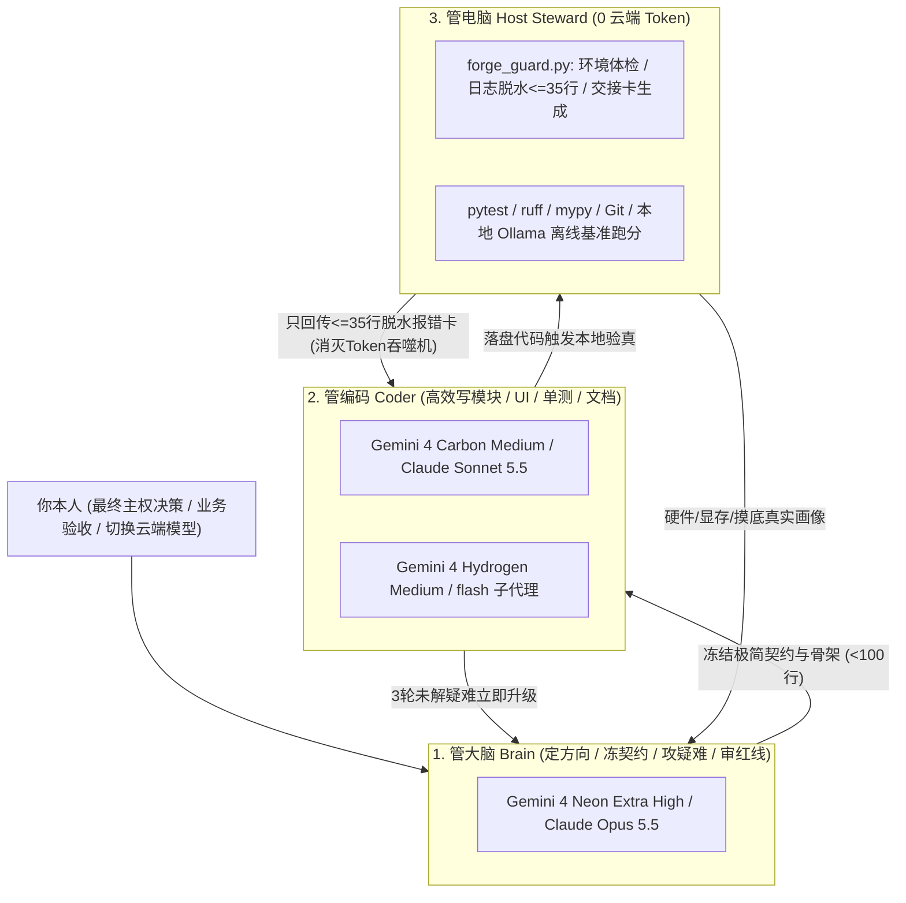

# 汇桥 OS “管大脑 / 管编码 / 管电脑”三岗分工与模型自动切换作战手册

> **核心理念（磨刀不误砍柴工）**：  
> 承认“Token 吞噬机”和“5 小时额度墙”客观存在，不靠省着不用，而是靠 **精确岗位分工 + 极简上下文卡片 + 本地零 Token 预处理 + 双池错峰切换**，让每一分云端配额都花在最高智商密度上，同时给模型留足自由发挥的创造空间。

---

## 一、三岗铁三角协作图

---

## 二、每块乐高积木的“分步模型切换剧本”（按阶段直接照抄执行）

> **通用动作**：每进入一块新积木，先在本机终端运行 `python forge/scripts/forge_guard.py brief MXX`，屏幕会直接打印该块**推荐切换的模型名**与**5 行开场粘贴指令**。

### Phase 0：立骨架与摸家底（预计 1 周 | 耗 Gemini 周额度 ~12–15%）

| 积木 | 步骤 1：定骨架与契约（管大脑） | 步骤 2：写实现与单测（管编码） | 步骤 3：实跑验真（管电脑 · 0 Token） |
| :--- | :--- | :--- | :--- |
| **`M00` 宪章与契约** | `Gemini 4 Neon (Extra High)` 定稿 `CONSTITUTION.md` 与 Pydantic 核心契约、`BrickRegistry` 接口 | 会话内派 `flash` 子代理或切 `Gemini 4 Hydrogen (Medium)` 补齐契约校验与 Mock 热换单测 | `forge_guard.py preflight` + `forge_guard.py test packages/core` |
| **`M01` 模型与显存网关** | `Gemini 4 Neon (Extra High)` 设计 VRAM 亲和队列、前缀缓存锁与 `<think>` 流式剥离器 | `Gemini 4 Carbon (Medium)` 写 `OllamaAdapter` / `LlamaSwapAdapter` 与并发模拟测试 | 本地实连 Ollama/llama-server 验证零外网与亲和排程 |
| **`M02` 能力摸底器** | 无需重脑力，直接用 `Gemini 4 Carbon (Medium)` 按契约生成 24 题离线微型基准套件与 Runner | `Gemini 4 Hydrogen (Medium)` 完善 Markdown 体检报告模板 | 本机跑 5–10 分钟离线实测，产出 `capability_profile.json` |

### Phase 1：拼出 100% 离线 Alpha MVP（预计第 2–3 周 | Gemini/Claude 双池错峰，各耗 ~25–35%）

| 积木 | 推荐主力模型切换 | 双池错峰与省 Token 要点 | 管电脑免费承担项 |
| :--- | :--- | :--- | :--- |
| **`M03` MCP 总线与文档解析** | **`Gemini 4 Carbon (Medium)`** | 全格式解析与 MCP 封装偏工程标准活，切 `Carbon` 直接省 55% 额度；单测派 `flash` 子代理 | 用本机真实 PDF/Word/Excel 样张跑通 `forge_guard.py test` |
| **`M04` Hooks 与三档模式** | **`Claude Sonnet 5.5 (Medium)`**（错峰切第二池！） | 安全拦截逻辑缜密，用刷新后的 Claude 池写极稳，同时为 Gemini 池腾出余量 | 本机跑 15 条越权与 `Ask` 禁写攻击单测 |
| **`M05` ADK 编排与断点续跑** | **`Gemini 4 Neon (Extra High)`**（管大脑出手！） | 五原语嵌套、SQLite WAL 断点续跑、流式改向属于核心状态机，用 `Neon Extra High` 一次成型少返工 | 本机脚本真实执行 `kill -9` 进程强杀与重启续跑验证 |
| **`M06` 路由与语义共创** | **`Claude Sonnet 5.5 (Medium)`** 或 `Gemini 4 Carbon` | `SemanticCoCreator` 增上启发语感与柔硬路由在 Claude/Carbon 上表现极佳 | 本机跑 20 条混合路由评测集，仅把误判项喂回模型调优 |
| **`M07` 网关/CLI/WebUI/5种子** | **`Gemini 4 Carbon (Medium)`**（WebUI 样式可派 `Hydrogen`） | 采用极简无构建轻量 WebUI 壳与 SQLite 方案，省掉 40% 前端重写 Token | 拔网线/断网防火墙实跑 5 个创世种子技能 |

### Phase 2：补齐工业级强执行底盘（预计第 4–5 周 | 耗双池各 ~25–30%）

| 积木 | 推荐主力模型切换 | 为什么这么切 | 管电脑免费承担项 |
| :--- | :--- | :--- | :--- |
| **`M08` 分级本地安全沙箱** | **`Claude Opus 5.5` / `Gemini 4 Neon (Extra High)`** | 涉及 Windows `AppContainer`/Job Object、macOS `sandbox-exec`、Linux `bwrap` 与 `microsandbox`/Docker 底层安全边界，必须“管大脑”级亲自把关 | 本机跑 15 条逃逸、死循环、外泄与权限红队测试 |
| **`M09` CodeAct + 上下文四件套 + Subagent** | **`Gemini 4 Neon (Extra High)`**（全项目核心硬核块） | 上下文防御压缩、压缩后强制重注宪章、逻辑隔离物理亲和 Subagent 必须由主将一气呵成 | 本机跑 25 轮长对话压测与 TTFT 前缀缓存耗时对比 |

### Phase 3–4：记忆、自演化与五维测试上线（预计第 6–7 周 | 耗双池各 ~25%）

| 积木 | 推荐主力模型切换 | 核心分工要点 | 管电脑免费承担项 |
| :--- | :--- | :--- | :--- |
| **`M10` 分层记忆与 1 秒反馈** | **`Gemini 4 Carbon (Medium)`** / `Claude Sonnet 5.5` | SQLite FTS5 + `sqlite-vec` + Git 自动提交偏成熟工程活，无需 `Extra High` | 本机实测历史冲突覆盖与冷拷贝重建索引 |
| **`M11` 双闸门防坍塌自演化** | **`Gemini 4 Neon (Extra High)`** + **`Claude Opus 5.5` 交叉复审** | 演化逻辑最怕“先升后崩”和违宪漏洞：Neon 写主逻辑，Claude 池做独立红队代码审计 | 本机沙箱跑 10 条伪造脚本与 10 条违宪诱导拦截验收 |
| **`INT-4` 五维评测与离线打包** | **`Gemini 4 Carbon (Medium)`** 写打包与回归脚本，异常项升级大脑 | 30 条 Golden 回归集与 48 小时灰度日志全程在本地跑，云端只看异常摘要 | 本机一键构建离线 ZIP Bundle + SHA256 + 48h 压测监控 |

---

## 三、实时防撞墙与“反 Token 吞噬机”操作口诀

1. **看水位再开工**：开工前瞄一眼右下角 `Usage`——当前池 `5h limit < 25%` 就切另一池，双池都紧就立刻收尾写账本去忙主线业务，绝不硬熬。
2. **三段式精准发指令**：发需求永远只写 3 件事：`① 本轮只做哪个子任务 → ② 硬底线/不可改的契约 → ③ 跑完哪个测试算完`。
3. **强制新开会话**：每块积木收工并写进 `PROGRESS_LEDGER.md` 后，**立刻开新会话**进入下一块；同一块若聊超 15 轮直接 `/compact`。
4. **先脱水再提问**：终端报错超过 30 行时，永远先跑 `python forge/scripts/forge_guard.py test ...`，只把精简诊断卡交给云端模型。
5. **3 轮不解必换脑**：编码手（`Carbon`/`Sonnet`）连续修同一个 Bug 3 轮失败，马上停止盲改，把最小复现交给“管大脑”主将（`Neon Extra High` / `Opus 5.5`）一次击穿。
